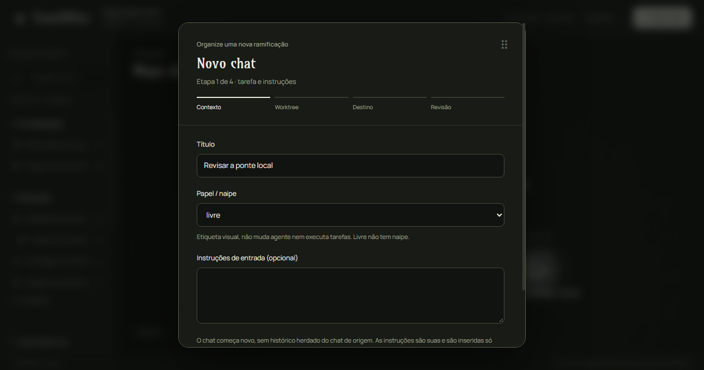

# TreeOffice

Um painel local que organiza seus chats do OpenCode numa árvore viva — orgânica,
animada e com cara de giz e cartas de baralho. Cada conversa vira um módulo na
árvore, e você enxerga de relance o que é liderança, execução, investigação ou
estudo, o que está parado e o que depende do quê.


Nada aqui é mágica nem automação: o painel só mostra e organiza. Criar chat,
worktree ou tarefa de verdade continua sendo uma decisão sua, com confirmação
explícita a cada passo. E tudo roda na sua máquina, sem conta, sem nuvem e sem
instalar nada além do Node.

## Como abrir

```bash
node src/iniciar.mjs
```

Isso sobe a ponte local e abre o painel no navegador. Para não abrir sozinho:

```bash
node src/iniciar.mjs --sem-abrir
```

- Endereço padrão: `http://127.0.0.1:4717` (só a sua máquina enxerga).
- O link vem com um token (`?token=...`) impresso no terminal — é ele que
  autoriza o navegador. O token mora em `.local/`, fora do Git.
- Para encerrar: `Ctrl+C`. Sua organização fica salva em `.local/state.json`.

Requisito: **Node 18.2+** (20/22 LTS recomendado). Funciona em Windows e Linux,
com os mesmos comandos.

## O que dá para fazer hoje

- **Ver a árvore** — módulos com naipes estampados (♠ liderança, ♥ execução,
  ♦ investigação, ♣ estudo; livre sem naipe), tamanhos que respiram conforme a
  atividade e fios que ligam grupos e dependências.
- **Organizar livremente** — arraste um módulo para onde quiser e ele fica lá;
  a posição é salva. Os vizinhos se afastam sozinhos e o centro do grupo
  acompanha os membros.
- **Explorar** — painel lateral com busca, espaços de trabalho e a lista de
  conexões, que também são clicáveis e selecionáveis.


- **Criar ramificações visuais** — um assistente em 4 etapas pergunta título,
  papel, contexto e worktree. Dá até para ramificar direto de um fio: o novo
  módulo nasce sobre a curva e a acompanha se as pontas mudarem.
- **Anotar fios** — cada conexão pode ter nome e notas digitadas por você,
  guardadas só no painel.



## O que o painel não faz (de propósito)

- Não cria sessões, branches, worktrees ou tarefas sozinho — criar e ramificar
  no painel é visual e simulado até a Fase C ser autorizada.
- Novos chats começam zerados, sem herdar conversa de ninguém (D04).
- Não lê seu vault do Obsidian, não varre seu disco e não muda configuração
  nenhuma do OpenCode.
- Não guarda conteúdo de conversa, notas, tokens ou credenciais — só
  identificadores, rótulos e preferências visuais (D23).

Os detalhes dessas proteções estão em
[docs/SEGURANCA.md](docs/SEGURANCA.md).

## Estado do projeto

A interface foi reformulada e aprovada em 14/10/2026 (D54–D57): tipografia
própria servida localmente (Amarante nos títulos, Manrope nos controles),
naipes no centro dos módulos, organização manual persistente, fios uniformes
selecionáveis e diálogos arrastáveis com transições suaves. O registro está em
[docs/UI-REFORMULADA-2026-10-14.md](docs/UI-REFORMULADA-2026-10-14.md).

Pelo roadmap ([docs/ROADMAP-V1.md](docs/ROADMAP-V1.md)):

| Fase | Situação |
| --- | --- |
| A — retomada e protótipo | Concluída |
| B — integração somente leitura | Implementada; faltando a UI de vínculo com sessões reais |
| C — criar chat e vincular worktree | Portão fechado, precisa da sua autorização |
| D — criar worktrees | Portão fechado |
| E — Tucofre e dependências | Fora da V1 por enquanto |
| F — instalação e validação assistida | Em andamento (este README faz parte) |

## Testes

Zero dependências, tudo com o Node que você já tem. São **190 verificações**,
todas verdes na última rodada (14/10/2026, incluindo navegador Edge de verdade
com perfil e árvore descartáveis):

| Comando | O que cobre | Checks |
| --- | --- | --- |
| `node tests/smoke.mjs` | ponte, token, persistência, fontes locais | 51 |
| `node tests/tree-render.mjs` | quem é desenhado e onde, naipes, tubos, tipo | 55 |
| `node tests/tree-interactions.mjs` | gestos, fios, ramificações, transições | 23 |
| `node tests/navigation.mjs` | explorador, busca, órfãos, ciclos | 8 |
| `node tests/visual-state.mjs` | normalização e persistência visual | 12 |
| `node tests/opencode-client.mjs` | Fase B contra serviço simulado | 27 |
| `node tests/browser-ui.mjs` | regressões no Chromium real | 14 |

Nenhum teste toca em projeto real, sessão verdadeira, vault ou configuração
global — está escrito na saída de cada suíte e é verificado de verdade.

## Estrutura

```text
TreeOffice/
├── README.md                  # este arquivo
├── AGENTS.md                  # instruções para assistentes do projeto
├── CONTEXTO-PROJETO.md        # histórico, requisitos e limites
├── docs/
│   ├── DECISOES.md            # decisões confirmadas (D01–D57) e pendências
│   ├── PLANEJAMENTO.md        # rodadas, etapas e critérios de aceite
│   ├── ROADMAP-V1.md          # fases A–F, portões e autorizações
│   ├── SEGURANCA.md           # proteções dos seus projetos
│   ├── PESQUISA.md            # referências, ecossistema e verificações
│   ├── PLANO-CONSOLIDADO.md   # arquitetura e contrato de dados
│   ├── CORRECOES-UI.md        # defeitos de UI já corrigidos, com evidências
│   ├── UI-REFORMULADA-2026-10-14.md  # a reforma atual, comportamento e validação
│   └── imagens/               # capturas reais do painel (para este README)
├── src/
│   ├── iniciar.mjs            # comando único de entrada
│   ├── server/bridge.mjs      # ponte local (token, persistência, modo real/simulado)
│   ├── shared/model.mjs       # contrato e normalização do estado
│   └── ui/                    # painel: Canvas 2D puro, sem build nem CDN
│       ├── assets/fonts/      # Amarante e Manrope (licenças OFL inclusas)
│       ├── app.js             # interface, explorador, diálogos, salvamento
│       ├── tree.js            # renderizador e física dos corpos
│       ├── navigation.mjs     # organização do explorador
│       └── connections.mjs    # ramificação sobre fios
├── tests/                     # as 7 suítes acima, sem rede e sem pacotes
├── assets/                    # recursos visuais próprios (hoje só `.gitkeep`)
└── scripts/                   # automações futuras, sempre explícitas
```

O estado de execução (sua árvore, token, backups) fica em `.local/`, fora do
versionamento. Projetos externos continuam onde estão — o painel se adapta a
eles, nunca o contrário.

## Documentação completa

- [CONTEXTO-PROJETO.md](CONTEXTO-PROJETO.md) — comece por aqui para entender de
  onde o projeto veio e onde parou.
- [docs/DECISOES.md](docs/DECISOES.md) — cada decisão, o que ela muda e o que
  ainda está em aberto.
- [docs/PLANEJAMENTO.md](docs/PLANEJAMENTO.md) — etapas, critérios de aceite e
  limites do escopo.
- [src/README.md](src/README.md) — execução e verificação do protótipo.

Repositório privado: <https://github.com/Artur-Lucena/TreeOffice>.
