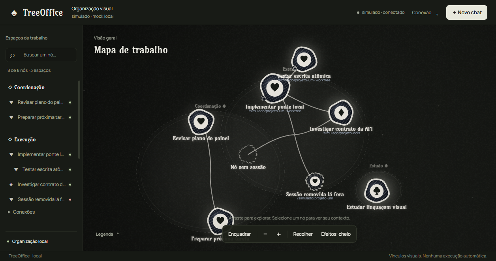
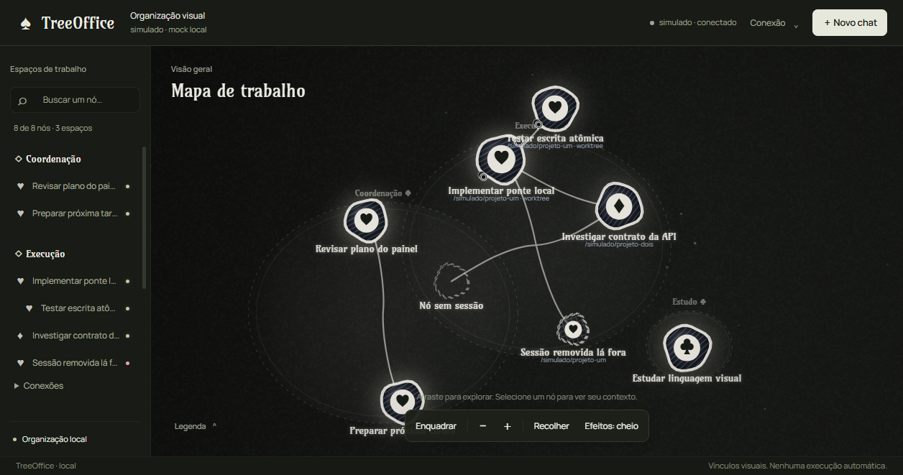

# TreeOffice

Um painel local que organiza seus chats do OpenCode numa árvore viva — orgânica,
animada, com cara de giz e baralho. Cada conversa vira um módulo; você vê de
relance o que é liderança (♠), execução (♥), investigação (♦) ou estudo (♣).



Tudo roda na sua máquina, sem conta, sem nuvem e sem instalar nada além do Node.
O painel só mostra e organiza — nada acontece sem você mandar.

## Abrir

```bash
node src/iniciar.mjs
```

Fecha com `Ctrl+C`. O link com token aparece no terminal; sua árvore fica em
`.local/`, fora do Git. Detalhes em [src/README.md](src/README.md).

## Faz / não faz

**Faz:** árvore arrastável com posições salvas, explorador com busca, fios
clicáveis com nome e notas, assistente de ramificação em 4 etapas.



**Não faz:** criar sessões, worktrees ou tarefas sozinho; herdar conversa entre
chats; ler seu vault; mudar qualquer configuração. Ver
[docs/SEGURANCA.md](docs/SEGURANCA.md).

## Onde estamos

Interface reformulada e aprovada em 14/10/2026 (D54–D57). Fase A concluída,
Fase B lendo o OpenCode em modo somente leitura. Fases C–F aguardam sua
autorização, uma por vez. O plano completo está em
[docs/ROADMAP-V1.md](docs/ROADMAP-V1.md).

## Testes

**190 verificações, todas verdes** (14/10/2026, com navegador real e dados
descartáveis):

```bash
node tests/smoke.mjs            # 51 — ponte, token, persistência
node tests/tree-render.mjs      # 55 — desenho, naipes, tipografia
node tests/tree-interactions.mjs # 23 — gestos, fios, ramificações
node tests/navigation.mjs       # 8 — explorador e busca
node tests/visual-state.mjs     # 12 — normalização e persistência
node tests/opencode-client.mjs  # 27 — leitura do OpenCode simulado
node tests/browser-ui.mjs       # 14 — regressões no Chromium real
```

## Pastas

- `src/` — painel e ponte (Node puro, sem dependências; fontes locais em `src/ui/assets/fonts/`)
- `tests/` — as 7 suítes acima
- `docs/` — decisões, roadmap, segurança e capturas (`docs/imagens/`)
- `.local/` — sua árvore e o token (fora do Git)

Contexto e decisões: [CONTEXTO-PROJETO.md](CONTEXTO-PROJETO.md) ·
[docs/DECISOES.md](docs/DECISOES.md) · [docs/PLANEJAMENTO.md](docs/PLANEJAMENTO.md)
